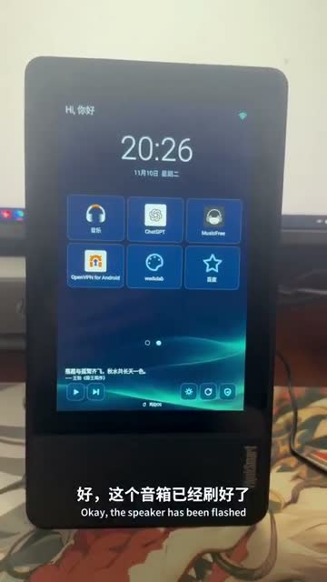
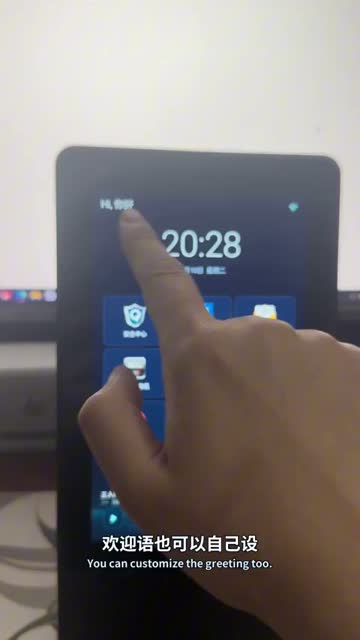
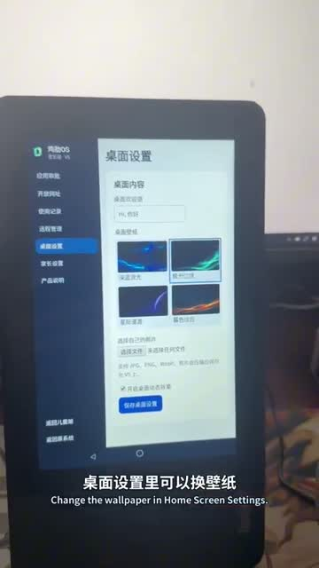

# ThinkSmart View · Jile OS V5

[简体中文](README.md) · [日本語](README.ja.md) · [English](README.en.md)

Turn an idle Lenovo ThinkSmart View into a learning and music station. Children launch the apps and websites you approve. Parents manage access on the device or over the home network.

## Hands-on demo

  

https://github.com/user-attachments/assets/b50a9013-09a9-40ed-bffd-b0f5892f4d65

[Watch the full demo on GitHub (1:39)](docs/media/thinksmart-v5-demo.mp4) · [Original X post](https://x.com/SamyeeiYu/status/2120146457353454033)

## Features

- **Child home screen** · Approved apps and websites, custom wallpapers, and media controls. Approved websites can open in the built-in browser.
- **Parent controls** · A six-digit PIN, foreground usage reports, a local web dashboard, and a way to return to the original launcher. Screen viewing requires Android permission on the device.
- **Manual updates** · With device management enabled, select Check and update in About. Updates require the same signing key and a higher version code.

The built-in learning browser ships with the APK. ChatGPT, music apps, Google Play services, and compatible firmware are provided separately by the user.

## Quick start

[GitHub Releases](https://github.com/samyeei/thinksmart-jilei-os/releases/latest)

1. Use a Lenovo ThinkSmart View V5 with compatible Android 8.1 firmware (API 27, ARMv7). Keep recovery materials, enable USB debugging, and confirm the target with `adb devices -l`.
2. Download `jile-os-v5.apk` from GitHub Releases. Run `adb -s <serial> install -t jile-os-v5.apk`. Add `-r` for updates signed with the same key.
3. Enter the initial setup code `123456` on the device and choose a new six-digit parent PIN. Set the default launcher and approve apps and sites. Enable accessibility for the in-app Home button, notification access for media controls, and usage access for reports as needed. Check the recovery path before enabling device management and Lock Task.
4. Find the parent dashboard address in Remote Management on the device. The dashboard uses HTTP on a trusted home network.

## Copy and paste into your AI agent

> Follow this repository to install Jile OS V5 on my USB-connected ThinkSmart View. Verify the model, firmware, ABI, ADB serial, and any existing signing certificate, then download and install the GitHub Release APK on the matching device while keeping existing data. Stop and explain if compatibility or signing is unclear or if flashing or wiping is required. Ask me to enter setup code 123456 and choose my own parent PIN on the device. https://github.com/samyeei/thinksmart-jilei-os

## Build from source

Install JDK 17, Gradle 9.8.2, Android SDK 37.2, and Build Tools 36.0.0. Set `JAVA_HOME` and `ANDROID_HOME` and run `python3 build.py`. The output is `dist/jile-os-v5.apk` signed with the local test key. Set `JILE_GRADLE` if Gradle is outside PATH.

`python3 scripts/prepare_ota.py <apk> <output-directory>` → `release.json` + APK. [OTA](https://raw.githubusercontent.com/samyeei/thinksmart-jilei-os/refs/heads/ota/release.json)

## License

© 2026 Samyeei. Source is available under PolyForm Noncommercial 1.0.0 for permitted noncommercial uses. [LICENSE](LICENSE) · [Third-party notices](THIRD_PARTY_NOTICES.md)
