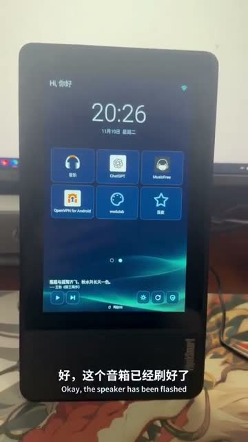
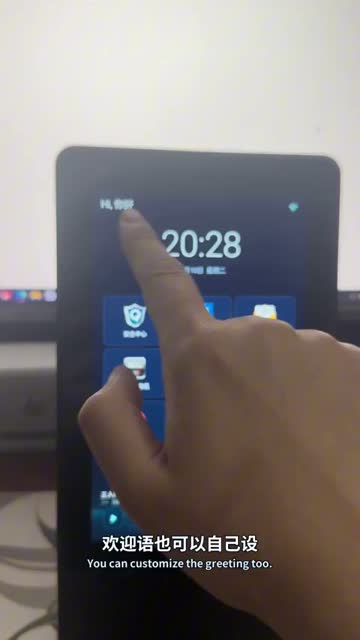
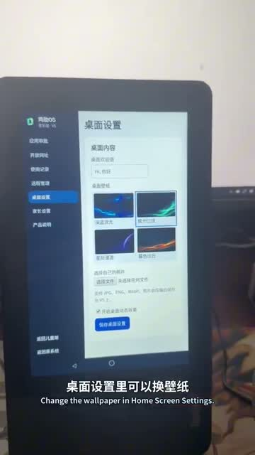

# ThinkSmart View · Jile OS V5（鸡肋OS）

[简体中文](README.md) · [日本語](README.ja.md) · [English](README.en.md)

使わなくなった Lenovo ThinkSmart View を、子どもの学習と音楽のための端末に。子どもは保護者が許可したアプリやサイトを利用でき、保護者は本体または家庭内の Wi-Fi から設定できます。

## 実機デモ

  

https://github.com/user-attachments/assets/b50a9013-09a9-40ed-bffd-b0f5892f4d65

[GitHubで動画を見る（1分39秒）](docs/media/thinksmart-v5-demo.mp4) · [Xの元の投稿](https://x.com/SamyeeiYu/status/2120146457353454033)

## 主な機能

- **子ども用ホーム** · アプリとサイトの許可、壁紙の変更、音楽再生の操作。許可されたサイトは内蔵ブラウザーで開けます。
- **保護者向け機能** · 6 桁の PIN、アプリの利用時間、家庭内の Web 管理画面、本体から元のホーム画面へ戻る機能。本体で Android の許可を与えると画面を確認できます。
- **ソフトウェア更新** · 端末管理を有効にすると、従量制でないネットワークで自動更新が既定で有効になります。「製品情報」で自動更新をオフにしたり、手動で更新を確認したりできます。更新には同じ署名と、より大きなバージョンコードが必要です。

内蔵ブラウザーは APK に含まれます。ChatGPT、音楽アプリ、Google Play サービス、対応ファームウェアは別途ご用意ください。

## インストール

[GitHub Releases](https://github.com/samyeei/thinksmart-jilei-os/releases/latest)

1. 対応する Android 8.1 ファームウェア（API 27、ARMv7）が動作する Lenovo ThinkSmart View V5 を使用します。復旧用の資料を確保し、USB デバッグを有効にして `adb devices -l` で対象を確認します。
2. GitHub Releases から `jile-os-v5.apk` を取得し、`adb -s <シリアル番号> install -t jile-os-v5.apk` を実行します。同じ署名の APK で上書きする場合は `-r` を追加します。
3. 本体で初期設定コード `123456` を入力し、新しい 6 桁の保護者 PIN を設定します。既定のホームを選択し、アプリとサイトを許可します。必要に応じてユーザー補助（ホームボタン）、通知へのアクセス（音楽操作）、使用状況へのアクセス（利用記録）を有効にします。端末管理や Lock Task を有効にする前に復旧手順を確認してください。
4. 管理画面のアドレスは本体の遠隔管理画面で確認できます。HTTP 接続は信頼できる家庭内ネットワークで利用してください。

## AI エージェントに渡す指示

> このリポジトリの手順に従って、USB 接続した ThinkSmart View に Jile OS V5 を導入してください。機種、ファームウェア、ABI、ADB のシリアル番号、既存アプリの署名を確認し、対象が一致したら GitHub Releases の APK を既存データを残してインストールしてください。互換性や署名が不明な場合、または書き換えや初期化が必要な場合は中断して理由を説明し、最後に本体で初期コード 123456 を入力して保護者 PIN を設定するよう案内してください。 https://github.com/samyeei/thinksmart-jilei-os

## ソースからビルド

JDK 17、Gradle 9.8.2、Android SDK 37.2、Build Tools 36.0.0 を用意します。`JAVA_HOME` と `ANDROID_HOME` を設定して `python3 build.py` を実行すると、ローカルのテスト鍵で署名した `dist/jile-os-v5.apk` が生成されます。Gradle の場所は `JILE_GRADLE` で指定できます。

`python3 scripts/prepare_ota.py <apk> <output-directory>` → `release.json` + APK. [OTA](https://raw.githubusercontent.com/samyeei/thinksmart-jilei-os/refs/heads/ota/release.json)

## ライセンス

© 2026 Samyeei. ソースコードは PolyForm Noncommercial 1.0.0 の条件に従い、許可された非商用目的で利用できます。 [LICENSE](LICENSE) · [Third-party notices](THIRD_PARTY_NOTICES.md)
