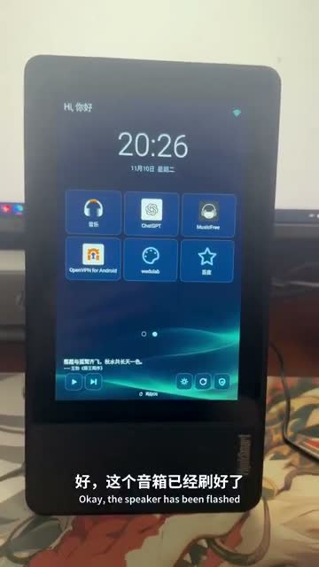
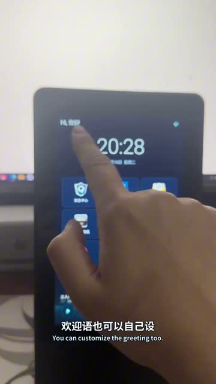
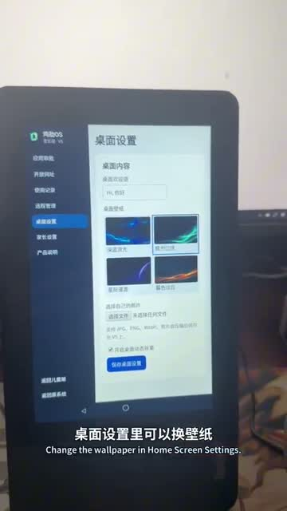

# ThinkSmart View · 鸡肋OS V5

[简体中文](README.md) · [日本語](README.ja.md) · [English](README.en.md)

把闲置的 Lenovo ThinkSmart View 变成孩子的学习和音乐桌面。孩子从桌面进入家长开放的应用和网站，家长可在设备上或家庭 Wi-Fi 内管理。

## 实机演示

  

https://github.com/user-attachments/assets/b50a9013-09a9-40ed-bffd-b0f5892f4d65

[在 GitHub 观看完整视频（1 分 39 秒）](docs/media/thinksmart-v5-demo.mp4) · [X 原帖](https://x.com/SamyeeiYu/status/2120146457353454033)

## 主要功能

- **儿童桌面** · 应用与网址审批、自选壁纸、媒体播放控制。开放网站可在内置浏览器中打开。
- **家长管理** · 六位 PIN、前台使用记录、局域网网页管理，以及从设备端切回原桌面。经设备系统授权后可查看屏幕。
- **手动更新** · 启用设备管理后，在「产品说明」点击「检查并更新」。更新包须同签名，且版本号更高。

演示中的 ChatGPT、音乐 App、Google Play 服务和兼容固件需自行准备。安装包内置学习浏览器。

## 快速安装

[GitHub Releases](https://github.com/samyeei/thinksmart-jilei-os/releases/latest)

1. 准备运行兼容 Android 8.1（API 27、ARMv7）固件的 Lenovo ThinkSmart View V5，保留恢复资料。开启 USB 调试，用 `adb devices -l` 核对目标设备。
2. 从 GitHub Releases 下载 `jile-os-v5.apk`，运行 `adb -s <序列号> install -t jile-os-v5.apk`。同签名覆盖升级时加 `-r`。
3. 在设备上输入初始设置码 `123456`，再自行设置六位家长 PIN。随后选择默认桌面并审批应用和网址。按需开启无障碍服务（应用内 Home 键）、通知访问（媒体控制）和使用情况访问（统计）。启用设备管理和 Lock Task 前确认恢复路径。
4. 家长网页地址在设备端的「远程管理」查看。网页使用 HTTP，适用于可信家庭局域网。

## 复制给 AI

> 请按这个仓库的说明把鸡肋OS V5 安装到我通过 USB 接入的 ThinkSmart View：先核对机型、固件、ABI、ADB 序列号及现有签名，再下载 GitHub Release APK 并安装到明确匹配的设备，保留原有数据；遇到机型不明、签名不符或需要刷机、清数据时停下说明，最后提示我在设备上用初始码 123456 设置自己的家长 PIN。 https://github.com/samyeei/thinksmart-jilei-os

## 自行构建

准备 JDK 17、Gradle 9.8.2、Android SDK 37.2 和 Build Tools 36.0.0，设置 `JAVA_HOME` 与 `ANDROID_HOME`，运行 `python3 build.py`。产物位于 `dist/jile-os-v5.apk`，使用本地构建机的测试签名。可用 `JILE_GRADLE` 指定 Gradle 路径。

`python3 scripts/prepare_ota.py <apk> <output-directory>` → `release.json` + APK. [OTA](https://raw.githubusercontent.com/samyeei/thinksmart-jilei-os/refs/heads/ota/release.json)

## 许可

© 2026 Samyeei. 源码按 PolyForm Noncommercial 1.0.0 公开，限许可允许的非商业用途。 [LICENSE](LICENSE) · [Third-party notices](THIRD_PARTY_NOTICES.md)
